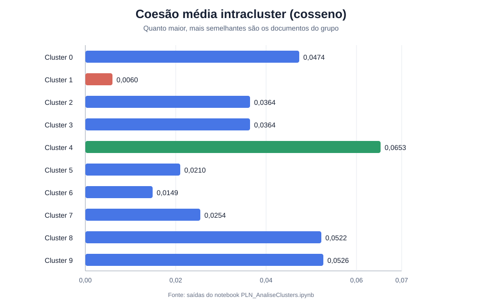
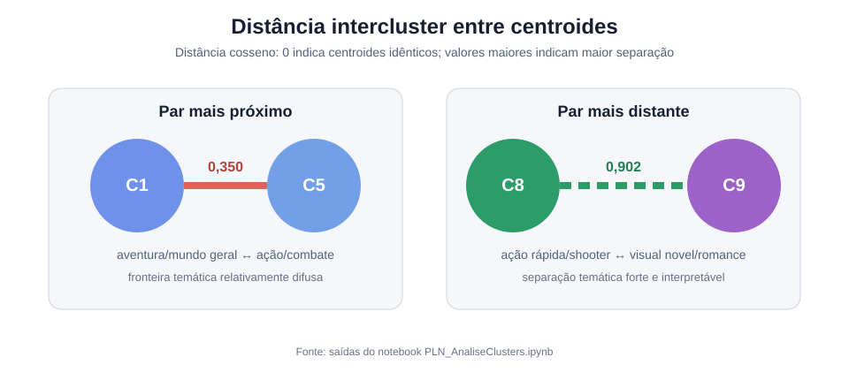
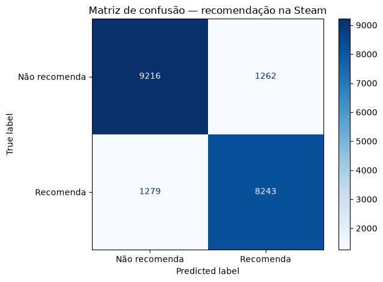
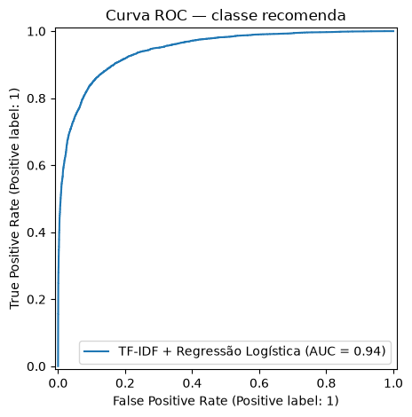
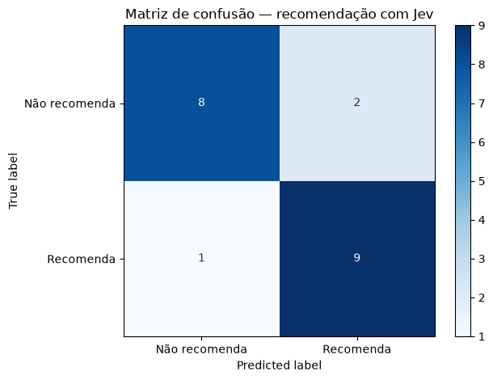
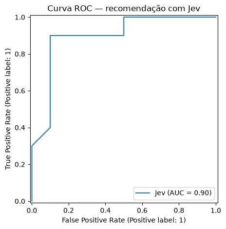
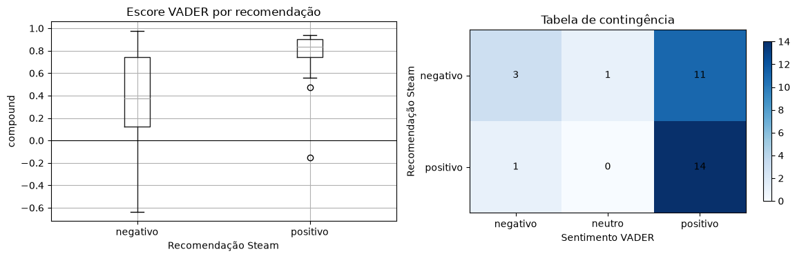
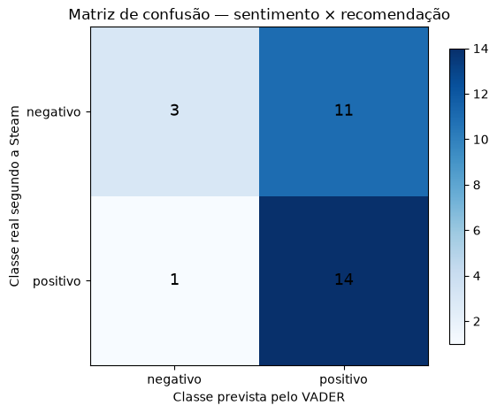

# PLN Steam Recommend

## Demo web: Django + React

O projeto inclui uma API Django REST e uma interface React/TypeScript para busca
Word2Vec, detalhes dos jogos e pontos positivos/negativos com evidências das reviews.
Consulte [instalação, preparação dos dados e contrato da API](docs/web-demo.md).
O demo usa os dados locais sem chave Steam; coleta autenticada requer `STEAM_API_KEY`
configurada apenas no ambiente do backend ou em `.env`.

Projeto de Processamento de Linguagem Natural aplicado ao catálogo e às avaliações de jogos da Steam. O objetivo é explorar descrições e opiniões de usuários para agrupar jogos, recuperar títulos relevantes, prever recomendações e extrair informação linguística.

## Dicionário dos dados

### Classe `Jogo`

| Campo | Descrição | Tipo |
|---|---|---|
| `appid` | ID único do jogo | `int` |
| `name` | Nome do jogo | `string` |
| `last_modified` | Última modificação na página do jogo | `timestamp` Unix |
| `price_change_number` | Identificador da última alteração de preço | `int` |
| `description` | Descrição do jogo | `string` |
| `genres` | Gêneros principais do jogo | `string` |
| `user_tags` | Tags atribuídas pelos usuários | `string` |

### Classe `Review`

| Campo | Descrição | Tipo |
|---|---|---|
| `appid` | ID único do jogo | `int` |
| `game_name` | Nome do jogo | `string` |
| `review_type` | Tipo da avaliação | `positive` ou `negative` |
| `voted_up` | Indica se o usuário recomendou o jogo | `bool` |
| `review` | Texto da avaliação | `string` |
| `timestamp_created` | Data de criação da avaliação | `timestamp` Unix |
| `votes_up` | Quantidade de votos de utilidade | `int` |
| `votes_funny` | Quantidade de votos de conteúdo engraçado | `int` |
| `weighted_score` | Peso de utilidade da avaliação | `double` |
| `playtime_forever` | Tempo total de jogo quando a avaliação foi feita | `int` |

### Justificativa da escolha

A Steam foi escolhida porque combina descrições de jogos, gêneros, tags e avaliações textuais livres. Esse material permite investigar tanto o conteúdo dos jogos quanto a opinião dos jogadores, o que é adequado para um sistema de busca e recomendação. As estruturas `Jogo` e `Review` são ligadas pelo `appid`.

### Formato das exportações

Os notebooks exportam DataFrames como pickle comprimido com gzip (`.pkl.gz`, protocolo 5, nível 1): catálogo e reviews em `_DadosBrutos/`, dados preparados em `_DadosLimpos/` e alternativas nas pastas `stemming/` e `lematizacao/`. Para ler os arquivos, utiliza-se `pd.read_pickle(caminho)`; as colunas de tokens continuam sendo listas Python.

Os arquivos JSON de controle — retomada, limite de requisições e cache de popularidade — mantêm seu formato. O checkpoint das reviews acompanha `steam_reviews.pkl.gz` como `steam_reviews.pkl.gz.state.json`.

No catálogo limpo usado nos notebooks, o CSV ocupava 276.647.478 bytes, o pickle 222.260.830 bytes e o pickle com gzip 109.902.712 bytes, uma redução de 60,3% em relação ao CSV.

## Técnicas executadas

| Etapa | BoW | TF-IDF | Word2Vec | BERT | Jev |
|---|:---:|:---:|:---:|:---:|:---:|
| Similaridade exploratória entre jogos | ✓ | ✓ |  |  |  |
| Clusterização com K-Means e PCA |  | ✓ |  |  |  |
| Busca por consulta em linguagem natural |  |  | ✓ | ✓ |  |
| Classificação de recomendação |  | ✓ |  |  | ✓ |

| Análise linguística | Situação |
|---|---|
| Análise de sentimentos | ( X ) Foi realizada   (   ) Não foi realizada |
| Reconhecimento de Entidades Nomeadas | ( X ) Foi realizada   (   ) Não foi realizada |
| Extração de relações | ( X ) Foi realizada   (   ) Não foi realizada |

## Análise dos clusters

### Representação e quantidade de clusters

O experimento completo de clusterização foi executado com **TF-IDF + K-Means, usando `k=10`**, sobre 179.464 descrições e 97.838 termos. BoW e TF-IDF foram calculados antes, mas somente TF-IDF foi usado no ajuste do K-Means. Portanto, não seria correto afirmar, a partir destas saídas, que TF-IDF venceu uma comparação de clusterização contra BoW, Word2Vec ou BERT. A conclusão sustentada pelos notebooks é mais restrita: **TF-IDF foi a representação que gerou os clusters avaliados e produziu grupos qualitativamente interpretáveis**.

Os dez grupos recuperam temas reconhecíveis nas palavras centrais e nos exemplos:

| Cluster | Termos/tema dominante | Nº de jogos |
|---:|---|---:|
| 0 | estratégia/RPG em turnos: `turn`, `rpg`, `strategy`, `combat`, `tactical` | 6.562 |
| 1 | aventura genérica: `world`, `find`, `adventure`, `life`, `time`, `way` | 70.330 |
| 2 | puzzles: `puzzle`, `puzzles`, `solve`, `levels`, `relaxing` | 9.721 |
| 3 | terror em primeira pessoa: `horror`, `first`, `psychological` | 9.878 |
| 4 | cooperação: `co-op`, `player`, `solo`, `friends`, `online` | 4.628 |
| 5 | ação/combate: `action`, `enemies`, `fight`, `shooter`, `rpg` | 22.425 |
| 6 | jogos multiplayer genéricos: `play`, `players`, `multiplayer`, `friends` | 30.504 |
| 7 | construção/defesa: `build`, `defense`, `tower`, `resources` | 13.791 |
| 8 | ação rápida/arcade/shooter: `fast`, `paced`, `action`, `shooter`, `arcade` | 6.559 |
| 9 | visual novel/romance: `novel`, `visual`, `story`, `adult`, `love`, `choices` | 5.066 |

Entre as configurações efetivamente executadas, **dez clusters foi a quantidade que melhor expressou as características originais**, pois separou nichos semânticos importantes — puzzle, terror, cooperação, estratégia, shooter e visual novel — sem fragmentá-los em dezenas de grupos difíceis de interpretar. Essa escolha é qualitativa: o notebook chama `k=10` de quantidade inicial e não registra uma varredura de valores de `k`, silhouette score ou elbow curve. Assim, `k=10` é uma solução útil e interpretável, não um ótimo matematicamente demonstrado. Uma avaliação futura deve testar, por exemplo, `k=5…30`, estabilidade entre sementes e silhouette em uma amostra estratificada.

### Métrica intracluster

A coesão é a similaridade cosseno média entre pares de jogos do mesmo cluster. Os melhores valores foram obtidos pelos clusters 4 (cooperação, **0,0653**), 9 (visual novel, **0,0526**), 8 (ação rápida, **0,0522**) e 0 (estratégia/RPG, **0,0474**). Isso é coerente com temas que possuem vocabulário relativamente específico.

O cluster 1 teve a menor coesão (**0,0060**) e concentrou 70.330 jogos, quase 40% do catálogo. Seus termos — `world`, `find`, `one`, `life`, `new`, `time` — são genéricos; o grupo funciona como um grande reservatório de descrições sem tema lexical forte. Os clusters 6 (**0,0149**) e 5 (**0,0210**) também são heterogêneos. Embora todos os valores absolutos sejam baixos, isso é esperado em textos curtos representados num espaço TF-IDF muito esparso; a comparação relativa entre os grupos é mais informativa que o valor isolado.

### Métrica intercluster

A distância usada foi `1 − similaridade cosseno` entre centroides. O par mais próximo foi **cluster 1 × cluster 5, distância 0,350**: aventura/mundo genérico e ação/combate compartilham palavras como `world`, `game` e `rpg`, sugerindo uma fronteira difusa. O par mais distante foi **cluster 8 × cluster 9, distância 0,902**: shooters/arcade rápidos e visual novels/romances possuem vocabulários claramente distintos. Essa separação forte reforça a validade qualitativa desses dois grupos.

As projeções PCA explicaram somente **0,6% da variância em 2D** e **0,9% em 3D**. Logo, os gráficos PCA são úteis para exploração, mas sobreposição visual neles não prova que os grupos sejam ruins: quase toda a informação do espaço TF-IDF foi descartada pela projeção. Para julgar os clusters, os termos centrais, exemplos, coesão e distância entre centroides são evidências mais confiáveis.

## Resultados das buscas

A consulta usada no notebook foi:

> `Explore an open world and build a base to survive with friends`

A busca comparou a consulta com 178.720 descrições por similaridade cosseno. Word2Vec foi treinado no próprio catálogo (97.647 palavras, 190 dimensões, Skip-gram); BERT usou `google-bert/bert-base-uncased`, mean pooling e vetores de 768 dimensões.

### Top-5 por representação

| Posição | Word2Vec | Similaridade | BERT | Similaridade |
|---:|---|---:|---|---:|
| 1 | Landiscape | 0,9396 | Island of the Lost | 0,8575 |
| 2 | Project 5: Sightseer | 0,9370 | First Men´s Life | 0,8544 |
| 3 | Isle of Survival: The New Dawn | 0,9366 | Last Message | 0,8537 |
| 4 | TerraTech Worlds | 0,9334 | Lost Island | 0,8518 |
| 5 | Shamania | 0,9332 | Team Ice Cream VR | 0,8484 |

### Avaliação crítica dos top-3 e top-5

**Word2Vec.** O top-3 foi muito consistente com a intenção da consulta. *Landiscape* menciona mundo aberto e jogo para 1–4 pessoas; *Project 5: Sightseer* é descrito como RPG sandbox multiplayer de mundo aberto; *Isle of Survival* enfatiza sobreviver e reconstruir numa ilha. Ao ampliar para top-5, *TerraTech Worlds* acrescenta explicitamente construção/crafting em mundo aberto e *Shamania* combina mundo aberto com sobrevivência. Assim, os cinco primeiros preservam quase todos os conceitos pedidos, ainda que o ranqueamento favoreça fortemente a coincidência lexical.

**BERT.** *Island of the Lost* e *First Men´s Life* são relevantes: sobrevivência, coleta, construção e exploração aparecem nas descrições. O terceiro resultado, *Last Message*, parece ter sido promovido principalmente por “chat with friends”, mas não atende bem a mundo aberto, base e sobrevivência. No top-5, *Lost Island* volta a ser semanticamente adequado, enquanto *Team Ice Cream VR* compartilha a ideia de jogar com um amigo, mas pouco do restante da intenção. Portanto, o BERT recuperou relações semânticas úteis, mas o top-5 foi menos preciso que o Word2Vec nesta consulta.

Os escores dos dois modelos **não devem ser comparados diretamente**, porque vêm de espaços vetoriais e distribuições diferentes. Além disso, `bert-base-uncased` com mean pooling não é um modelo treinado especificamente para similaridade de sentenças; isso ajuda a explicar vizinhos semanticamente genéricos.

### Uso real e melhorias

Os resultados são utilizáveis como **geração de candidatos**, especialmente o Word2Vec desta consulta, mas ainda não bastam para uma recomendação de produção. Não há avaliação com várias consultas, julgamento humano, Precision@k, Recall@k ou NDCG; também não entram preferência do usuário, preço, popularidade, idioma ou qualidade do jogo.

Uma solução melhor poderia:

1. combinar Word2Vec e BERT por *reciprocal rank fusion* ou média de escores normalizados;
2. incluir um sinal lexical BM25/TF-IDF para preservar termos obrigatórios, como `open world` e `survival`;
3. trocar o BERT base por um *sentence transformer* treinado para busca semântica;
4. reranquear os candidatos com gêneros, tags, popularidade, avaliações e restrições explícitas da consulta;
5. avaliar diversas consultas com relevância anotada por pessoas e métricas em `k=3` e `k=5`.

## Classificador

### TF-IDF + Regressão Logística

Foi possível treinar um classificador supervisionado para prever `recomenda` ou `nao_recomenda`. Depois da limpeza, foram usados 100.000 textos: 80.000 para treino e 20.000 para teste estratificado. A representação contém unigramas e bigramas TF-IDF, limitada a 40.000 atributos; a decisão é feita por Regressão Logística com pesos balanceados.

| Modelo | Acurácia | Acurácia balanceada | F1 macro | ROC-AUC |
|---|---:|---:|---:|---:|
| Baseline: classe majoritária | 0,524 | — | 0,344 | — |
| TF-IDF + Regressão Logística | **0,873** | **0,873** | **0,873** | **0,944** |

  
  

<em>Matriz de confusão e curva ROC do classificador supervisionado, extraídas das saídas do notebook.</em>

O desempenho foi equilibrado entre as classes: para `nao_recomenda`, precision/recall/F1 foram 0,878/0,880/0,879; para `recomenda`, 0,867/0,866/0,866. O modelo aprendeu sinais interpretáveis. `boring`, `not worth`, `refund`, `unplayable`, `terrible` e `worst` favoreceram a classe negativa; `fun`, `great`, `not bad`, `love`, `amazing`, `definitely` e `excellent` favoreceram a positiva. Os bigramas são importantes para preservar negações como `not worth` e `not bad`.

Em seis textos novos escritos manualmente, o modelo classificou corretamente todos os casos esperados, inclusive frases mistas:

| Exemplo resumido | Previsão | `P(recomenda)` |
|---|---|---:|
| “Amazing game… worth the price” | recomenda | 0,9955 |
| “crashes constantly… cannot recommend” | não recomenda | 0,0182 |
| “some problems, but… great time” | recomenda | 0,9592 |
| “Beautiful graphics, terrible controls…” | não recomenda | 0,0252 |
| “Not perfect, yet… definitely recommend” | recomenda | 0,9925 |

Apesar disso, houve 2.541 erros no conjunto de teste. Reviews mistas, atualizações de opinião, ironia, textos que elogiam o jogo mas registram voto negativo e frases longas com muitas ressalvas continuam difíceis para um modelo linear.

### Jev e comparação das representações

Também foi usado o **Jev**, um modelo externo de decisão (*System One*, TypeSafe AI), por meio da primitiva `Noul`. Ele recebeu diretamente o texto integral, sem stemming, lematização, remoção de stopwords ou treino no corpus local. Em uma amostra balanceada de 20 reviews, completou 20/20 chamadas e obteve acurácia e F1 macro de **0,850**, com ROC-AUC **0,895** e três erros. Em cinco textos novos, tratou corretamente exemplos positivos, negativos e uma recomendação com ressalva; classificou como negativa a frase ambígua “I played for hours and I am still not sure if it was worth it” (`0,32`).

  
  

<em>Matriz de confusão e curva ROC do Jev. A curva em degraus reflete a amostra reduzida de 20 reviews.</em>

Não é uma comparação estatística direta: TF-IDF foi testado em 20.000 exemplos, enquanto Jev foi testado em apenas 20 por custo de API. Nas evidências disponíveis, **TF-IDF com unigramas e bigramas foi a representação textual mais precisa e mais bem validada para classificação**. Jev mostrou potencial para compreender negação e opinião mista sem treinamento, mas precisa ser avaliado numa amostra maior e tem dependência de serviço externo.

Foram usadas, portanto, duas famílias de técnicas:

- **modelo de decisão supervisionado:** Regressão Logística sobre TF-IDF, treinada com rótulos da Steam;
- **modelo externo de linguagem/decisão:** Jev, aplicado diretamente ao texto em regime semelhante a *zero-shot*.

BERT também é um modelo de linguagem, mas neste projeto foi utilizado na busca semântica, não no classificador.

## Análise de sentimentos, entidades e relações

As três técnicas são aplicáveis, mas com graus diferentes de confiabilidade. O notebook avaliou uma amostra balanceada de 30 reviews em inglês, 15 recomendadas e 15 não recomendadas.

### Análise de sentimentos

O VADER classificou 29 das 30 reviews como positivas ou negativas e uma como neutra. Comparado ao voto da Steam, obteve:

| Métrica | Resultado |
|---|---:|
| Cobertura não neutra | 0,967 |
| Concordância global | 0,567 |
| Acurácia nos 29 casos não neutros | 0,586 |
| Precisão da classe positiva | 0,560 |
| Revocação da classe positiva | 0,933 |
| F1 da classe positiva | 0,700 |

O boxplot mostra que as reviews recomendadas tendem a escores `compound` mais altos, mas existe grande sobreposição: várias reviews não recomendadas também receberam escore positivo. A tabela de contingência explicita essa assimetria.

A matriz binária teve 3 negativos corretos, 11 negativos classificados como positivos, 1 positivo classificado como negativo e 14 positivos corretos. O método apresentou forte tendência a prever sentimento positivo. Isso acontece porque sentimento e recomendação não são idênticos: uma pessoa pode elogiar aspectos do jogo e ainda não recomendá-lo. Sarcasmo, comparações, negação complexa e vocabulário informal também causaram divergências. VADER é útil para triagem, agregação de opinião e como atributo adicional, mas não deve substituir sozinho o voto de recomendação.

### Reconhecimento de Entidades Nomeadas

O spaCy encontrou **25 menções** na amostra, incluindo datas e durações (`2007`, `about 10 minutes`, `a few hours`), idiomas (`English`), produtos ou jogos (`Cookie Clicker`, `Steam Deck`, `Alien Shooter Vengeance`) e organizações (`MMO`). A tarefa pode apoiar a identificação de jogos citados, plataformas, versões, datas e requisitos.

A qualidade, porém, foi irregular: `Cookie Clicker`, `Steam Deck`, `Alien Shooter Vengeance` e até emojis foram classificados como `PERSON`, enquanto `MMO` foi classificado como `ORG`. Isso mostra incompatibilidade parcial entre as categorias gerais do modelo e o domínio de jogos. Para uso real, seria necessário normalizar o texto, criar padrões com `EntityRuler`, usar o catálogo Steam como gazetteer e, idealmente, ajustar um modelo com entidades anotadas do domínio.

### Extração de relações

As regras sobre dependências sintáticas extraíram **76 relações** sujeito–relação–objeto. Há saídas úteis, como `This game — release_on → Steam`, `This game — release_in → 2007` e `I — like → it`. Também há relações frágeis ou excessivamente literais, como `it — be → what` e objetos muito longos. Reviews são informais, frequentemente omitem sujeito, usam pronomes e contêm fragmentos, o que limita regras SVO simples.

A extração é aplicável para construir atributos e grafos — por exemplo, jogo → lançado em → data, jogo → executa em → plataforma, jogador → elogia/critica → aspecto — desde que sejam adicionadas resolução de correferência, normalização dos predicados, filtragem por entidades e validação manual de uma amostra.

## Conclusão

As técnicas estudadas contribuem diretamente para o objetivo apresentado na Unidade 1. A clusterização organiza o catálogo em temas; a busca Word2Vec/BERT transforma uma necessidade em candidatos; o classificador estima a intenção de recomendar; e sentimento, entidades e relações acrescentam sinais explicáveis sobre opinião, produtos e aspectos mencionados. O melhor desenho para o recomendador é híbrido: recuperar candidatos por sinais lexicais e semânticos, reranquear com metadados e preferência do usuário e usar as análises de reviews como evidências complementares.

Os resultados já demonstram viabilidade, mas não encerram a validação. Antes de uso real, são necessárias avaliações com mais consultas, anotação humana, métricas de ranking, testes de diferentes valores de `k`, validação temporal do classificador e monitoramento de vieses e erros por gênero de jogo.

## Uso de IA generativa

O ChatGPT (GPT-5.6 Sol) via Codex foi utilizado como apoio à criação e revisão dos scripts e desta documentação. As métricas e exemplos apresentados acima foram obtidos das saídas executadas dos notebooks do repositório.
